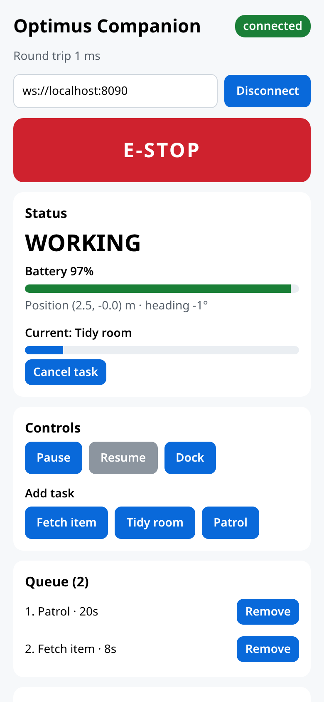
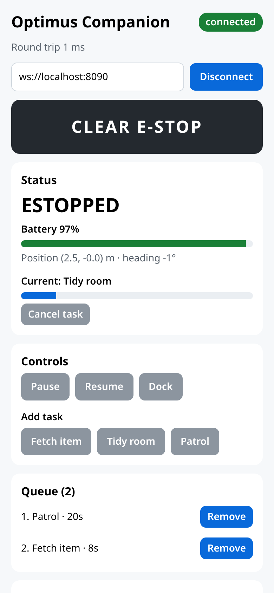
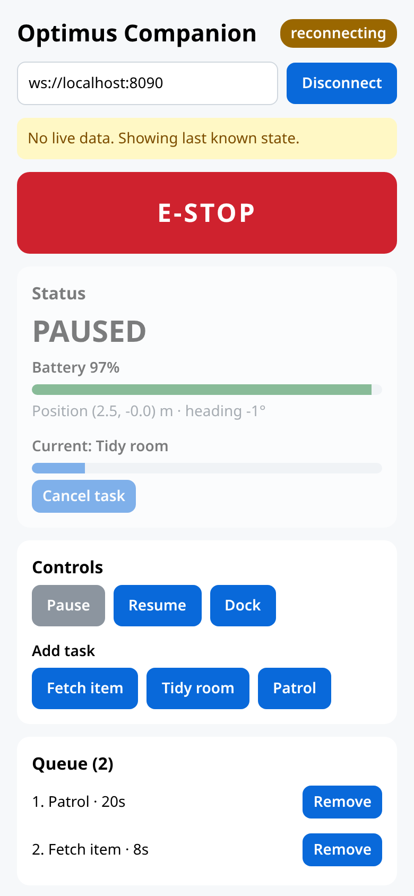

# Optimus Companion

A React Native (Expo, TypeScript) app for directing and monitoring a humanoid-style robot, plus a Node.js robot simulator to drive it. Runs on iOS, Android, and web.



## What it does

- **Live status:** mode, battery, position, heading, and progress on the current task, streamed at 10 Hz.
- **Control:** queue tasks (fetch, tidy, patrol), cancel or remove tasks, pause, resume, and send the robot to its dock.
- **Emergency stop:** a large E-STOP button. Clearing it asks for confirmation and leaves the robot paused, so the operator has to press Resume before it moves again.
- **Honest connection state:** if telemetry stops for 2 s, the app dims the status card and shows "No live data. Showing last known state." instead of presenting old data as current.

## Design

```
app/                     React Native client
  App.tsx                UI
  src/protocol.ts        Wire protocol shared with the simulator
  src/RobotClient.ts     WebSocket link: reconnect, heartbeat, acks, offline queue
  src/store.ts           Reducer for app state (pure, unit tested)
  src/backoff.ts         Jittered exponential backoff
simulator/               Node.js robot simulator
  src/robot.ts           Robot state machine (pure, unit tested)
  src/server.ts          WebSocket server, input validation, chaos flags
  src/e2e.test.ts        Real RobotClient against the real simulator process
```

**Protocol.** JSON over one WebSocket. The robot sends `telemetry` (with a sequence number), `ack`, `event`, and `pong`. The app sends `command` and `ping`.

**Link handling (`RobotClient`).**
- Reconnects with full-jitter exponential backoff (500 ms base, 15 s cap).
- Pings every second. A link with no traffic for 3 s is treated as dead and reconnected, which catches half-open sockets that never fire `onclose`.
- Every command has an id and a 3 s ack timeout. A late ack still updates the command.
- Telemetry with a sequence number at or below the last one is dropped, so the UI never moves backwards. The counter resets on reconnect in case the robot restarted.

**Command safety.**
- Ordinary commands issued while offline are queued and sent on reconnect. Commands that were sent but not acked when the link dropped are re-sent with the **same id**. The robot dedupes by id, so a retry is never applied twice.
- E-stop is **never queued**. If the app is offline, the command fails at once with "E-stop was NOT delivered; use the robot's physical stop." A stop that arrives seconds late is worse than a clear failure.
- The simulator validates every incoming message and rejects all motion commands while e-stopped.

**Simulator.** Walks to a task location, works for the task's duration, drains battery by mode, refuses to start a task below 20%, and auto-docks at 15%, putting the interrupted task back at the front of the queue. Chaos flags:
- `SIM_DROP_RATE=0.05` randomly drops connections.
- `SIM_ACK_DELAY_MS=4000` delays acks past the client timeout.

## Run it

Requires Node 22.18+ (runs TypeScript directly).

```bash
# 1. Robot simulator
cd simulator && npm install && npm start          # ws://0.0.0.0:8080 (PORT to change)

# 2. App
cd app && npm install && npx expo start
```

Open the app in Expo Go on your phone (or press `w` for web). On a phone, set the address to your computer's LAN IP, e.g. `ws://192.168.1.20:8080`.

## Tests

```bash
cd app && npm test && npm run typecheck          # 15 tests: reducer, backoff, parsing, RobotClient with fake timers
cd simulator && npm test && npm run typecheck    # 9 tests: robot state machine, input validation, end-to-end
```

## Screenshots

| Working | E-stopped | Link lost |
|---|---|---|
|  |  |  |
